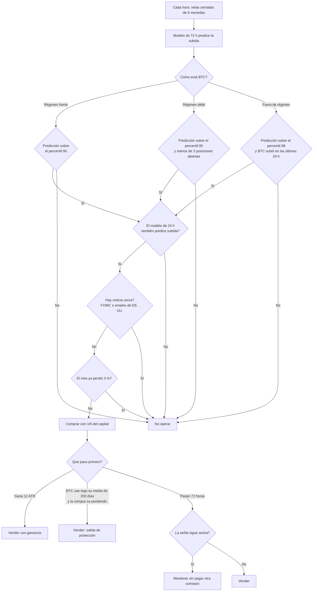
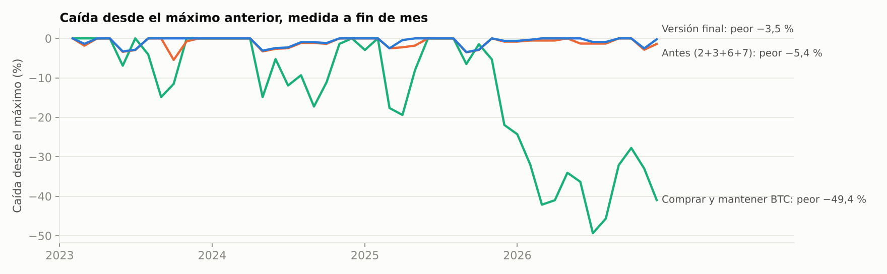

# Resumen ilustrado: de la idea del video a la versión final

Qué se probó, qué se descartó y cómo quedó la estrategia de trading con aprendizaje automático. Todo es backtest con
velas reales de 1 min de Binance spot (BTC, ETH, BNB, XRP, SOL, DOGE), solo compras y después de costos. Datos del
11 de agosto de 2020 al 13 de noviembre de 2026; los resultados se miden de 2023 a 2026. Los detalles
y todas las tablas están en [`estrategias-multimarco.md`](estrategias-multimarco.md) y
[`estrategia-pullback.md`](estrategia-pullback.md).

> **Documento de referencia. Léelo primero en cada sesión nueva.**
> Aquí está la estrategia vigente: la que se está trabajando para implementarla en el bot y probarla en trading real.
> Si este documento y otro no coinciden, vale este.

## Estado actual (14 de noviembre de 2026)

| Punto | Estado |
|---|---|
| Estrategia vigente | Versión final de este documento (etapa 8, clave `7e` de `meses8.py`) |
| Dónde existe hoy | Solo como backtest en Python: `binance-research/multitf/` |
| Bot en vivo (Node/TypeScript) | Todavía no ejecuta esta estrategia |
| Probada con dinero real o en papel | No |
| Rama de trabajo | `Improvement-experiment-on-v3` |

Lo que falta para llevarla a producción, en orden:

1. **Pasar las reglas al bot.** Calcular cada hora las 23 variables con velas cerradas, cargar el modelo del mes y
   aplicar las reglas de la tabla de [Cómo opera la versión final](#cómo-opera-la-versión-final).
2. **Reentreno mensual.** Un proceso que el día 1 de cada mes entrene los modelos de 72 h y de 24 h y guarde sus
   percentiles de validación.
3. **Comprobar que el bot y el backtest coinciden.** Con las mismas velas, las señales del bot deben ser las mismas
   que las de `meses8.py`.
4. **Prueba en papel o testnet** durante al menos un mes, comparando cada operación con el backtest.
5. **Dinero real con tamaño pequeño**, y solo si la prueba en papel se parece al backtest.

Las cifras de este documento son de backtest y las reglas se eligieron viendo estos mismos años: el resultado real
será peor. Ver [Límites](#límites-que-hay-que-tener-presentes).

## En una frase

La versión final gana los cuatro años probados (2023 a 2026), con una caída máxima de −3,5 %, y en 2026 gana
+22,1 % con 7 meses positivos de 11. Casi toda la ganancia de 2026 viene de agosto.

## Cómo leer este documento

| Si quieres saber | Ve a |
|---|---|
| Qué hace el bot, paso a paso | [Cómo opera la versión final](#cómo-opera-la-versión-final) |
| Por qué está cada regla y qué aportó | [Qué aporta cada regla](#qué-aporta-cada-regla) |
| Cuánto gana y cuánto puede caer | [Resultados de la versión final](#resultados-de-la-versión-final) |
| Qué no se debe creer de estas cifras | [Límites que hay que tener presentes](#límites-que-hay-que-tener-presentes) |
| Dónde están los archivos del backtest | [Dónde están los resultados del backtest](#dónde-están-los-resultados-del-backtest) |

Palabras que se usan:

| Palabra | Significado |
|---|---|
| Backtest | Simular la estrategia sobre precios del pasado |
| Régimen fuerte | BTC cierra el día sobre su media de 200 días |
| Régimen débil | BTC está bajo su media de 200 días, pero sobre su EMA de 50 días y esa EMA sube |
| Fuera de régimen | Ninguna de las dos cosas: mercado bajista o lateral |
| Percentil 90 | La predicción está entre el 10 % más alto de las que el modelo dio en su periodo de validación |
| ATR | Cuánto se mueve el precio en una hora normal (explicado más abajo) |
| Caída máxima | La mayor bajada de la cuenta desde un máximo, medida a fin de mes |

## El recorrido


| Etapa | Qué se hizo | Qué se aprendió |
|---|---|---|
| 0. Video de *scalping* | Dirección en 1 h, estructura en 5 min, gatillo en 1 min; 12.288 combinaciones | Pierde: la comisión (0,24 %) es mayor que el objetivo (0,15 %) |
| 1. Tres estrategias multi-marco | Aprendizaje automático, fuerza relativa semanal y tendencia en cascada | Solo el aprendizaje automático mostró ventaja (2024 y 2025), pero perdió en 2026 |
| 2. Historia y régimen | Entrenar desde 2020 y operar solo con BTC en tendencia alcista | Primer 2026 positivo (+4,7 %), con solo 2 meses positivos |
| 3. Modelo de 72 h | Predecir 3 días en lugar de 1 | Gana cerca de 2 % por operación: el costo pesa poco |
| 4. Reentreno mensual | Un modelo nuevo cada mes | La caída máxima baja de −14,4 % a −6,1 % |
| 5. Acuerdo, umbral, objetivo y BNB | Cuatro reglas de entrada y salida | 2026 sube a +13,2 % y 5 meses positivos |
| 6. Fuera de régimen, renovar y noticias | Compras selectivas fuera de régimen, renovar sin costo y filtro de noticias | 2026 sube a +19,6 % sin aumentar la caída máxima |
| 7. Tope en régimen débil | Máximo 3 posiciones abiertas cuando el régimen es débil | 2026 pasa de 5 a 7 meses positivos sin empeorar ningún año |
| 8. Salida de protección | Vender una compra que va perdiendo si BTC cae bajo su media de 200 días | La caída máxima baja de −5,4 % a −3,5 % y el total sube de +457,7 % a +490,8 % |

Lo que se descartó en el camino, y por qué:

- **Stops ajustados y salidas anticipadas:** cortan operaciones que luego se recuperaban.
- **Interruptores por rendimiento reciente:** se apagan justo antes de las rachas buenas.
- **Más monedas (12):** no añaden meses positivos y suben la caída máxima.
- **Ventas en corto (futuros):** ganan algunos meses bajistas y pierden otros; sin mejora neta.
- **Intereses (Earn flexible):** fuera del proyecto, que es de trading.
- **Filtros de tendencia de la moneda o de BTC a corto plazo:** quitan tantas compras ganadoras como perdedoras.
- **Stop de pérdida fijo (6 u 8 ATR):** vende en el peor momento; baja todos los años.

## Cómo opera la versión final



El bot decide una vez por hora, con la vela de esa hora ya cerrada, y compra en la apertura de la hora siguiente.
Nunca usa información del futuro.

| Pieza | Regla |
|---|---|
| Modelo | LightGBM con 23 variables de minuto, hora, día y calendario. Predice cuánto subirá cada moneda en las próximas 72 h. Se reentrena el día 1 de cada mes con toda la historia desde 2020 |
| Régimen | Fuerte: BTC sobre su media de 200 días. Débil: BTC bajo esa media, pero sobre su EMA de 50 días con esa EMA subiendo. Si no, fuera de régimen |
| Entrada en régimen fuerte | Predicción sobre el percentil 90 y mayor que el costo; el modelo de 24 h también predice subida |
| Entrada en régimen débil | Lo mismo con el percentil 95, y solo si hay menos de 3 posiciones abiertas |
| Entrada fuera de régimen | Solo si la predicción supera el percentil 98, BTC subió en las últimas 24 h y el modelo de 24 h predice subida |
| Noticias | Sin entradas desde 24 h antes hasta 2 h después de FOMC o empleo de EE. UU. |
| Salida con ganancia | Al ganar 12 ATR |
| Salida de protección | Para compras hechas en régimen fuerte: si al cerrar una hora BTC está bajo su media de 200 días y el precio de la moneda está bajo el precio de compra, se vende en la apertura de la hora siguiente |
| Salida por tiempo | A las 72 h; si la señal sigue activa, se mantiene sin pagar otra comisión |
| Riesgo | 1/6 del capital por operación, una por moneda; el mes se detiene al perder 3 % |
| Costo | 0,19 % por operación (comisión pagada con BNB más deslizamiento) |

## Qué aporta cada regla

| Regla | Problema que resuelve | Efecto medido |
|---|---|---|
| Predecir 72 h en lugar de 24 h | Con ganancias pequeñas por operación, la comisión se come la ventaja | Cada operación gana cerca de 2 % neto |
| Reentreno mensual | Un modelo entrenado una vez al año se queda viejo | Caída máxima de −14,4 % a −6,1 % |
| Filtro de régimen | El modelo pierde cuando el mercado cae | Primer 2026 positivo |
| Acuerdo con el modelo de 24 h | Evita comprar cuando el corto plazo apunta abajo | Más meses positivos |
| Percentil 98 fuera de régimen, con BTC subiendo | Aprovecha rebotes fuertes en mercado bajista sin comprar caídas | Agosto de 2026: de +14,3 % a +20,4 % |
| Renovar sin costo | No pagar comisión por vender y recomprar lo mismo | Sube todos los años |
| Filtro de noticias | Las horas alrededor de FOMC y empleo son impredecibles | Caída máxima no sube |
| Tope de 3 posiciones en régimen débil | En régimen débil el bot compraba las 6 monedas a la vez y caían juntas | Abril y mayo de 2026 pasan a positivo: 7 meses de 11 |
| Salida de protección | Una compra hecha con mercado alcista se quedaba 72 h aunque el mercado se diera vuelta | Caída máxima de −5,4 % a −3,5 %; total de +457,7 % a +490,8 % |

### La salida de protección, con sus operaciones

Es la última regla añadida. Entre 2023 y 2026 cambia 18 operaciones: 14 salen mejor y 4 salen peor.

| Fecha de compra | Moneda | Sin la regla | Con la regla | Diferencia |
|---|---|---|---|---|
| 30 ago 2023 | SOL | −10,67 % | −4,07 % | +6,60 |
| 30 ago 2023 | XRP | −7,08 % | −1,22 % | +5,86 |
| 30 ago 2023 | BTC | −6,25 % | −0,71 % | +5,54 |
| 30 ago 2023 | ETH | −5,16 % | −1,04 % | +4,12 |
| 30 ago 2023 | DOGE | −3,52 % | −0,36 % | +3,16 |
| 30 sep 2024 | DOGE | −11,38 % | −2,67 % | +8,71 |
| 9 mar 2025 | SOL | −2,36 % | −0,19 % | +2,17 |
| 9 mar 2025 | DOGE | −2,85 % | −1,66 % | +1,19 |
| 13 mar 2025 | SOL | +7,03 % | −2,37 % | **−9,40** |
| 13 mar 2025 | DOGE | +4,94 % | −1,65 % | **−6,59** |
| 28 mar 2025 | XRP | −6,35 % | −0,20 % | +6,15 |
| 28 mar 2025 | SOL | −3,61 % | −0,52 % | +3,09 |
| 28 mar 2025 | BNB | −3,44 % | −1,12 % | +2,32 |
| 28 mar 2025 | ETH | −1,79 % | −0,37 % | +1,42 |
| 15 oct 2025 | XRP | −4,40 % | −7,14 % | **−2,74** |
| 15 oct 2025 | BNB | −5,08 % | −7,51 % | **−2,43** |
| 3 nov 2025 | DOGE | −4,90 % | −3,74 % | +1,16 |
| 10 nov 2026 | BTC | −6,09 % | −2,59 % | +3,50 |

Cada porcentaje es el resultado de esa operación; en la cuenta pesa una sexta parte. El costo de la regla está en
2025: las dos compras del 13 de marzo se habrían recuperado, y por eso 2025 baja de +20,5 % a +19,8 %. Se aceptó
ese costo a cambio de la menor caída máxima y del mayor total.

### Qué es el ATR

ATR significa *Average True Range* (rango verdadero promedio). Mide cuánto se mueve el precio de una moneda en una hora normal, sin importar si sube o baja. Sirve para que el objetivo de ganancia se adapte a cada moneda: una moneda tranquila tiene un objetivo cercano y una moneda agitada tiene un objetivo más lejano.

Se calcula en dos pasos, con velas de 1 hora:

1. **Rango verdadero** de cada hora: el mayor de estos tres valores.

   | Valor | Qué mide |
   |---|---|
   | máximo − mínimo | El recorrido dentro de la hora |
   | \|máximo − cierre anterior\| | El recorrido si hubo un salto hacia arriba |
   | \|mínimo − cierre anterior\| | El recorrido si hubo un salto hacia abajo |

2. **Promedio** del rango verdadero de las últimas horas, con suavizado de Wilder de 14 períodos:

   ```
   ATR(hora actual) = ATR(hora anterior) × 13/14 + rango verdadero(hora actual) × 1/14
   ```

El bot usa el ATR como porcentaje del precio (ATR ÷ cierre). El objetivo de venta es:

```
precio objetivo = precio de entrada × (1 + 12 × ATR en porcentaje)
```

Ejemplo: se compra a 100 y el ATR de esa hora es 0,5 % del precio. El objetivo es 12 × 0,5 % = 6 %, es decir, vender a 106. Si el precio no llega a 106 en 72 horas, se vende al precio que haya en ese momento.

## Resultados de la versión final


| Año | Ganancia | Comprar y mantener BTC |
|---|---|---|
| 2023 | +77,5 % | +155,6 % |
| 2024 | +127,4 % | +121,3 % |
| 2025 | +19,8 % | −6,3 % |
| 2026 (hasta el 13 de noviembre) | +22,1 % | −22,1 % |
| **Total** | **+490,8 %** | **+313,0 %** |

Con 100 USDT al empezar 2023, la versión final termina en 591 USDT y comprar y mantener BTC en 413 USDT.



La estrategia gana menos que BTC cuando el mercado sube con fuerza (2023) y evita casi todas sus caídas: su peor
caída es −3,5 % frente a −49,4 % de BTC.

### Mes a mes


33 de 47 meses son positivos. Ganancia de cada mes, en % de la cuenta (0 es un mes sin operaciones):

| Mes | 2023 | 2024 | 2025 | 2026 |
|---|---|---|---|---|
| Enero | +16,34 | +1,94 | +8,40 | +0,28 |
| Febrero | −1,37 | +17,61 | −2,52 | +0,65 |
| Marzo | +11,52 | +22,33 | +2,14 | 0 |
| Abril | +5,54 | −3,11 | +0,45 | +0,65 |
| Mayo | −3,31 | +0,68 | +3,42 | +0,56 |
| Junio | +0,44 | +0,16 | +0,82 | −0,91 |
| Julio | +8,34 | +1,36 | +5,56 | 0 |
| Agosto | +0,73 | 0 | −3,48 | +20,42 |
| Septiembre | 0 | −0,22 | +0,63 | +0,42 |
| Octubre | +4,14 | +5,56 | +4,06 | −2,54 |
| Noviembre | +6,50 | +38,29 | −0,62 | +2,37 (hasta el día 13) |
| Diciembre | +11,79 | +7,49 | 0 | |
| **Año** | **+77,48** | **+127,43** | **+19,84** | **+22,14** |
| Meses positivos | 9 de 12 | 9 de 12 | 8 de 12 | 7 de 11 |

En 2026 son 7 de 11:


| Mes de 2026 | Etapa 5 | Etapa 6 | Etapa 7 | Versión final |
|---|---|---|---|---|
| Enero | +0,28 % | +0,28 % | +0,28 % | +0,28 % |
| Febrero | 0 | +0,65 % | +0,65 % | +0,65 % |
| Marzo | 0 | 0 | 0 | 0 |
| Abril | +1,13 % | −0,26 % | **+0,65 %** | +0,65 % |
| Mayo | −1,31 % | −0,02 % | **+0,56 %** | +0,56 % |
| Junio | 0 | −0,91 % | −0,91 % | −0,91 % |
| Julio | 0 | 0 | 0 | 0 |
| Agosto | +14,31 % | +20,42 % | +20,42 % | +20,42 % |
| Septiembre | +0,36 % | +0,42 % | +0,42 % | +0,42 % |
| Octubre | −2,88 % | −2,54 % | −2,54 % | −2,54 % |
| Noviembre (en curso) | +1,52 % | +1,79 % | +1,79 % | **+2,37 %** |
| **Año** | **+13,20 %** | **+19,64 %** | **+21,44 %** | **+22,14 %** |
| Meses positivos | 5 de 11 | 5 de 11 | 7 de 11 | 7 de 11 |

## Las dos últimas etapas frente a sus condiciones

Etapa 7 (tope en régimen débil): la condición era no empeorar nada de la etapa 6 y llegar a 7 meses positivos de 11
en 2026. Se cumplió todo.

Etapa 8 (salida de protección): la condición era no empeorar nada de la etapa 7 y subir septiembre, octubre y
noviembre de 2026. De 93.612 combinaciones probadas, ninguna lo cumple todo. Se eligió la que menos rompe:

| Medida | Etapa 6 | Etapa 7 | Versión final | Frente a la etapa 7 |
|---|---|---|---|---|
| 2023 | +69,86 % | +69,86 % | +77,48 % | Mejor |
| 2024 | +124,31 % | +124,31 % | +127,43 % | Mejor |
| 2025 | +20,53 % | +20,53 % | +19,84 % | **Peor (−0,69 puntos)** |
| 2026 | +19,64 % | +21,44 % | +22,14 % | Mejor |
| Total | +449,4 % | +457,7 % | +490,8 % | Mejor |
| Caída máxima | −5,45 % | −5,45 % | −3,48 % | Mejor |
| Meses positivos de 47 | 31 | 33 | 33 | Igual |
| Meses positivos de 2026 | 5 | 7 | 7 | Igual |
| Febrero de 2026 | +0,65 % | +0,65 % | +0,65 % | Igual |
| Septiembre de 2026 | +0,42 % | +0,42 % | +0,42 % | Igual |
| Octubre de 2026 | −2,54 % | −2,54 % | −2,54 % | Igual |
| Noviembre de 2026 | +1,79 % | +1,79 % | +2,37 % | Mejor |

Septiembre y octubre no mejoraron: las reglas que quitan sus compras perdedoras también quitan compras ganadoras de
2023 o 2024.

## Límites que hay que tener presentes

- **Es un backtest.** No se ha probado con dinero real ni en papel con datos nuevos.
- **Sobreajuste.** Las reglas se eligieron entre cientos de combinaciones viendo estos mismos años, sobre todo 2026.
  La ganancia real esperable es menor que la de las tablas.
- **2026 depende de agosto:** +20,4 % en un mes; los otros seis meses positivos suman cerca de +5 %.
- **El tope en régimen débil se apoya en 5 operaciones.** Entre 2023 y 2026 solo quita 5 compras, todas de abril y
  mayo de 2026 y todas perdedoras. En 2022, un año que no entra en las tablas, habría quitado operaciones ganadoras
  (ese año pasa de +4,4 % a +1,5 %). Abril y mayo quedan positivos por poco (+0,65 % y +0,56 %).
- **La salida de protección se apoya en 18 operaciones** y baja 2025 en 0,69 puntos. En 2022 no cambia nada.
- **Octubre sigue negativo** (−2,54 %) y septiembre apenas gana (+0,42 %).
- **Solo compras:** en meses bajistas lo mejor que puede hacer es no operar.

Siguiente paso recomendado: correr la versión final en papel con datos nuevos antes de usar dinero.

## Dónde están los resultados del backtest

Todos están en `binance-research/multitf/output/`:

| Archivo | Contenido |
|---|---|
| `meses8_resumen.json` | Último backtest: la versión final es la clave `7e` dentro de `individuales`; incluye las otras variantes y las combinaciones más cercanas |
| `meses8_mensual.csv` | Ganancia de cada mes desde 2020; la versión final es la columna `7e` y la etapa 7 es `base` |
| `meses8_combinaciones.csv` | Las combinaciones que suben septiembre a noviembre y menos condiciones rompen |
| `meses7_resumen.json`, `meses7_mensual.csv`, `meses7_combinaciones.csv` | Backtest de la etapa 7 (clave y columna `5c`) |
| `meses6_resumen.json`, `meses6_mensual.csv` | Backtest de la etapa 6 |
| `meses*_resumen.json` anteriores | Rondas anteriores, descritas en `estrategias-multimarco.md` |

En los archivos las ganancias mensuales están en fracción (0,0237 es +2,37 %) en los `.csv` y en % en los `.json`.

Código de cada etapa, en `binance-research/multitf/`: `meses6.py` (etapa 6), `meses7.py` (etapa 7), `meses8.py`
(etapa 8) y `graficos.py` (gráficos de este documento).

## Cómo reproducirlo

```
cd binance-research/pullback
python descargar.py --desde 2020-01 --salida ../v3_research/tmp/k1m_2020
cd ../multitf
python meses6.py
python meses7.py --combos
python meses8.py --combos
python graficos.py
```

La descarga se conecta a `data.binance.vision`; si falla con la VPN activa, desactívala para ese paso.
