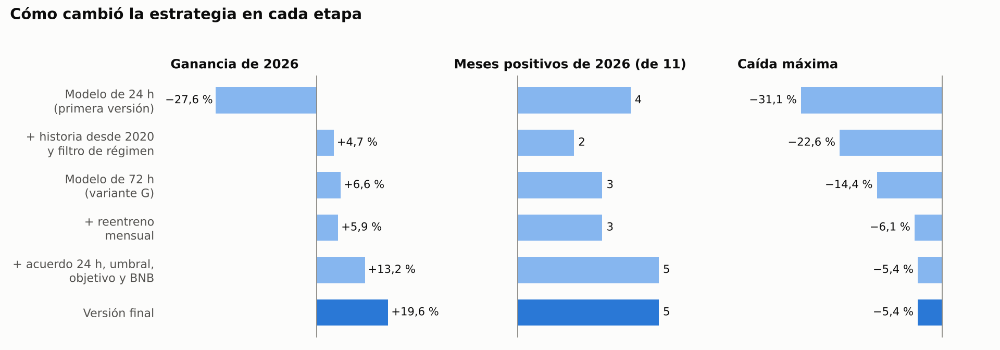
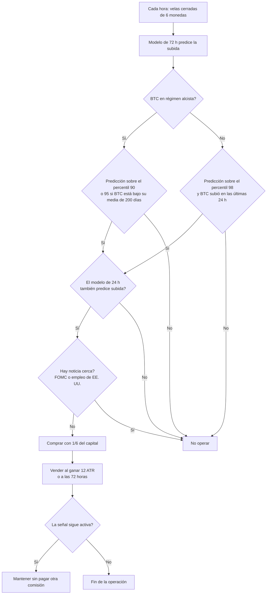
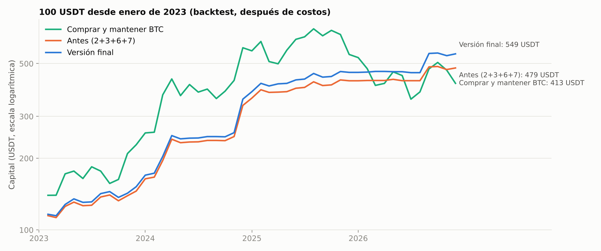

# Resumen ilustrado: de la idea del video a la versión final

Qué se probó, qué se descartó y cómo quedó la estrategia de trading con aprendizaje automático. Todo es backtest con
velas reales de 1 min de Binance spot (BTC, ETH, BNB, XRP, SOL, DOGE), solo compras y después de costos. Los detalles
y todas las tablas están en [`estrategias-multimarco.md`](estrategias-multimarco.md) y
[`estrategia-pullback.md`](estrategia-pullback.md).

## En una frase

La versión final gana los cuatro años probados (2023 a 2026), con una caída máxima de −5,4 %, y en 2026 gana
+19,6 % con 5 meses positivos de 11. Casi toda la ganancia de 2026 viene de agosto.

## El recorrido



| Etapa | Qué se hizo | Qué se aprendió |
|---|---|---|
| 0. Video de *scalping* | Dirección en 1 h, estructura en 5 min, gatillo en 1 min; 12.288 combinaciones | Pierde: la comisión (0,24 %) es mayor que el objetivo (0,15 %) |
| 1. Tres estrategias multi-marco | Aprendizaje automático, fuerza relativa semanal y tendencia en cascada | Solo el aprendizaje automático mostró ventaja (2024 y 2025), pero perdió en 2026 |
| 2. Historia y régimen | Entrenar desde 2020 y operar solo con BTC en tendencia alcista | Primer 2026 positivo (+4,7 %), con solo 2 meses positivos |
| 3. Modelo de 72 h | Predecir 3 días en lugar de 1 | Gana cerca de 2 % por operación: el costo pesa poco |
| 4. Reentreno mensual | Un modelo nuevo cada mes | La caída máxima baja de −14,4 % a −6,1 % |
| 5. Acuerdo, umbral, objetivo y BNB | Cuatro reglas de entrada y salida | 2026 sube a +13,2 % y 5 meses positivos |
| 6. Versión final | Compras selectivas fuera de régimen, renovar sin costo y filtro de noticias | 2026 sube a +19,6 % sin aumentar la caída máxima |

Lo que se descartó en el camino, y por qué:

- **Stops ajustados y salidas anticipadas:** cortan operaciones que luego se recuperaban.
- **Interruptores por rendimiento reciente:** se apagan justo antes de las rachas buenas.
- **Más monedas (12):** no añaden meses positivos y suben la caída máxima.
- **Ventas en corto (futuros):** ganan algunos meses bajistas y pierden otros; sin mejora neta.
- **Intereses (Earn flexible):** fuera del proyecto, que es de trading.

## Cómo opera la versión final



| Pieza | Regla |
|---|---|
| Modelo | LightGBM con 23 variables de minuto, hora, día y calendario. Se reentrena el día 1 de cada mes con toda la historia desde 2020 |
| Régimen alcista | BTC sobre su media de 200 días, o sobre su EMA de 50 días con esa EMA subiendo |
| Entrada | Predicción sobre el percentil 90 (95 con régimen débil) y mayor que el costo; el modelo de 24 h también predice subida |
| Fuera de régimen | Solo si la predicción supera el percentil 98 y BTC subió en las últimas 24 h |
| Noticias | Sin entradas desde 24 h antes hasta 2 h después de FOMC o empleo de EE. UU. |
| Salida | Al ganar 12 ATR o a las 72 h; si la señal sigue, se mantiene sin pagar otra comisión |
| Riesgo | 1/6 del capital por operación, una por moneda; el mes se detiene al perder 3 % |
| Costo | 0,19 % por operación (comisión pagada con BNB más deslizamiento) |

## Resultados de la versión final



| Año | Ganancia | Comprar y mantener BTC |
|---|---|---|
| 2023 | +69,9 % | +155,6 % |
| 2024 | +124,3 % | +121,3 % |
| 2025 | +20,5 % | −6,3 % |
| 2026 (hasta el 13 de noviembre) | +19,6 % | −22,1 % |
| **Total** | **+449,4 %** | **+313,0 %** |


La estrategia gana menos que BTC cuando el mercado sube con fuerza (2023) y evita casi todas sus caídas: su peor
caída es −5,4 % frente a −49,4 % de BTC.

### Mes a mes


31 de 47 meses son positivos. En 2026 son 5 de 11:


| Mes de 2026 | Antes (2+3+6+7) | Versión final |
|---|---|---|
| Enero | +0,28 % | +0,28 % |
| Febrero | 0 | +0,65 % |
| Marzo | 0 | 0 |
| Abril | +1,13 % | −0,26 % |
| Mayo | −1,31 % | −0,02 % |
| Junio | 0 | −0,91 % |
| Julio | 0 | 0 |
| Agosto | +14,31 % | +20,42 % |
| Septiembre | +0,36 % | +0,42 % |
| Octubre | −2,88 % | −2,54 % |
| Noviembre (en curso) | +1,52 % | +1,79 % |
| **Año** | **+13,20 %** | **+19,64 %** |

## Condiciones que cumple la versión final

| Condición | Antes | Versión final | Cumple |
|---|---|---|---|
| Septiembre, octubre y noviembre mejores | +0,36 / −2,88 / +1,52 | +0,42 / −2,54 / +1,79 | Sí |
| 2026 positivo | +13,20 % | +19,64 % | Sí |
| Febrero no negativo | 0 | +0,65 % | Sí |
| 2024 no baja | +118,4 % | +124,3 % | Sí |
| La caída máxima no sube | −5,45 % | −5,45 % | Sí |

## Límites que hay que tener presentes

- **Es un backtest.** No se ha probado con dinero real ni en papel con datos nuevos.
- **Sobreajuste.** Las reglas se eligieron entre cientos de combinaciones viendo estos mismos años, sobre todo 2026.
  La ganancia real esperable es menor que la de las tablas.
- **2026 depende de agosto:** +20,4 % en un mes; los otros cuatro meses positivos suman menos de +3,2 %.
- **Octubre sigue negativo** (−2,54 %) y noviembre incluye una pérdida reciente de −6,09 % en BTC (10 al 13 de
  noviembre).
- **Solo compras:** en meses bajistas lo mejor que puede hacer es no operar.

Siguiente paso recomendado: correr la versión final en papel con datos nuevos antes de usar dinero.

## Cómo reproducirlo

```
cd binance-research/pullback
python descargar.py --desde 2020-01 --salida ../v3_research/tmp/k1m_2020
cd ../multitf
python meses6.py
python graficos.py
```

La descarga se conecta a `data.binance.vision`; si falla con la VPN activa, desactívala para ese paso.
