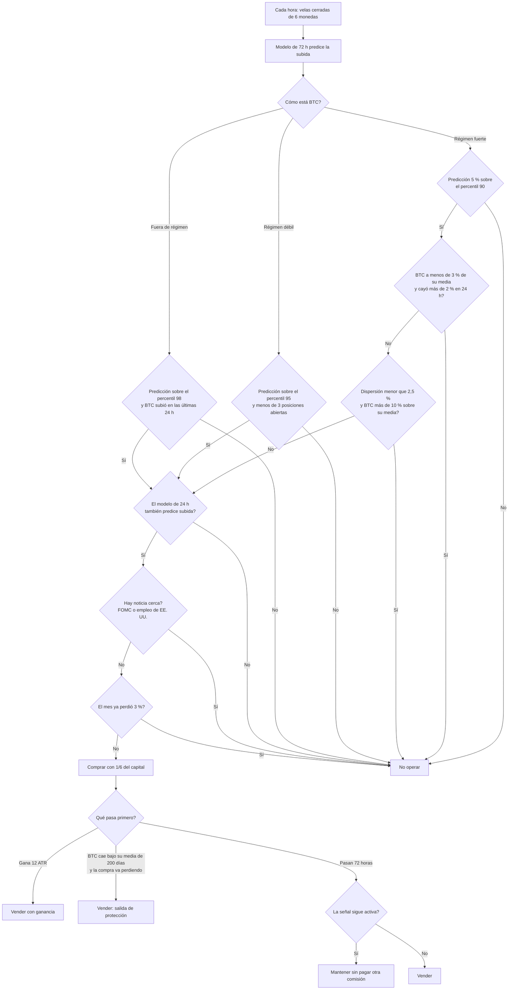
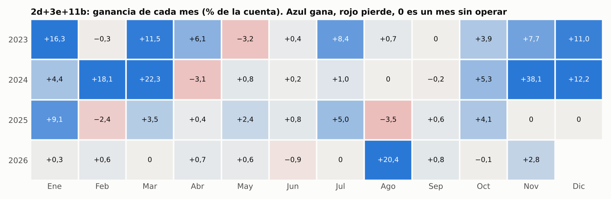
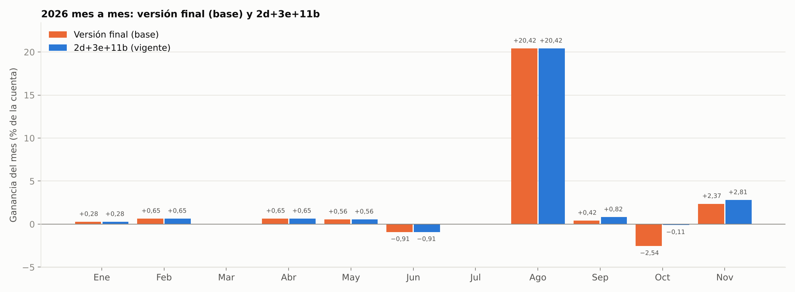

# Resumen ilustrado: de la idea del video a la estrategia vigente

Qué se probó, qué se descartó y cómo quedó la estrategia de trading con aprendizaje automático. Todo es backtest con
velas reales de 1 min de Binance spot (BTC, ETH, BNB, XRP, SOL, DOGE), solo compras y después de costos. Datos del
11 de agosto de 2020 al 13 de noviembre de 2026; los resultados se miden de 2023 a 2026. Los detalles
y todas las tablas están en [`estrategias-multimarco.md`](estrategias-multimarco.md) y
[`estrategia-pullback.md`](estrategia-pullback.md).

> **Documento de referencia. Léelo primero en cada sesión nueva.**
> Aquí está la estrategia vigente: la que se está trabajando para implementarla en el bot y probarla en trading real.
> Si este documento y otro no coinciden, vale este.

## Estado actual (14 de noviembre de 2026)

| Punto | Estado |
|---|---|
| Estrategia vigente | **2d+3e+11b** (etapa 9): la versión final de la etapa 8 más tres filtros de entrada en régimen fuerte. Clave `2d+3e+11b` de `meses9.py` |
| Base de comparación | Versión final de la etapa 8 (clave `7e` de `meses8.py`, clave `base` de `meses9.py`) |
| Dónde existe hoy | Solo como backtest en Python: `binance-research/multitf/` |
| Bot en vivo (Node/TypeScript) | Todavía no ejecuta esta estrategia |
| Probada con dinero real o en papel | No |
| Rama de trabajo | `Improvement-experiment-on-v3` |

Nombres que se usan en este documento:

| Nombre | Qué es |
|---|---|
| **2d+3e+11b** | La estrategia vigente |
| **Versión final (base)** | La estrategia anterior, de la etapa 8. Es contra la que se compara 2d+3e+11b |
| **Otras** | Las versiones más viejas (etapas 1 a 7). Aparecen en los gráficos solo como referencia |

Lo que falta para llevarla a producción, en orden:

1. **Pasar las reglas al bot.** Calcular cada hora las 23 variables con velas cerradas, cargar el modelo del mes y
   aplicar las reglas de la tabla de [Cómo opera 2d+3e+11b](#cómo-opera-2d3e11b). Los tres filtros nuevos solo
   necesitan datos que el bot ya calcula: la predicción y su percentil 90, la media de 200 días de BTC, la subida de
   BTC en 24 h y la subida de cada moneda en 7 días.
2. **Reentreno mensual.** Un proceso que el día 1 de cada mes entrene los modelos de 72 h y de 24 h y guarde sus
   percentiles de validación.
3. **Comprobar que el bot y el backtest coinciden.** Con las mismas velas, las señales del bot deben ser las mismas
   que las de `meses9.py`.
4. **Prueba en papel o testnet** durante al menos un mes, comparando cada operación con el backtest.
5. **Dinero real con tamaño pequeño**, y solo si la prueba en papel se parece al backtest.

Las cifras de este documento son de backtest y las reglas se eligieron viendo estos mismos años: el resultado real
será peor. Ver [Límites](#límites-que-hay-que-tener-presentes).

## En una frase

2d+3e+11b gana los cuatro años probados (2023 a 2026), con una caída máxima de −3,5 %, y en 2026 gana +26,2 % con
7 meses positivos de 11. Frente a la versión final (base) sube todos los años, no aumenta la caída máxima y lleva
octubre de 2026 de −2,54 % a −0,11 %. Casi toda la ganancia de 2026 sigue viniendo de agosto.

## Cómo leer este documento

| Si quieres saber | Ve a |
|---|---|
| Qué hace el bot, paso a paso | [Cómo opera 2d+3e+11b](#cómo-opera-2d3e11b) |
| Qué se hizo en cada etapa hasta llegar aquí | [El recorrido](#el-recorrido) |
| Cómo se llegó a los tres filtros nuevos | [Cómo se llegó a 2d+3e+11b](#cómo-se-llegó-a-2d3e11b) |
| Por qué está cada regla y qué aportó | [Qué aporta cada regla](#qué-aporta-cada-regla) |
| Cuánto gana y cuánto puede caer | [Resultados de 2d+3e+11b](#resultados-de-2d3e11b) |
| Qué no se debe creer de estas cifras | [Límites que hay que tener presentes](#límites-que-hay-que-tener-presentes) |
| Dónde están los archivos del backtest | [Dónde están los resultados del backtest](#dónde-están-los-resultados-del-backtest) |

Palabras que se usan:

| Palabra | Significado |
|---|---|
| Backtest | Simular la estrategia sobre precios del pasado |
| Régimen fuerte | BTC cierra el día sobre su media de 200 días |
| Régimen débil | BTC está bajo su media de 200 días, pero sobre su EMA de 50 días y esa EMA sube |
| Fuera de régimen | Ninguna de las dos cosas: mercado bajista o lateral |
| Percentil 90 | La predicción está entre el 10 % más alto de las que el modelo dio en su periodo de validación |
| Distancia a la media | Cuánto está BTC por encima de su media de 200 días, en % |
| Dispersión | Qué tan distinto subieron las seis monedas en los últimos 7 días (explicado más abajo) |
| ATR | Cuánto se mueve el precio en una hora normal (explicado más abajo) |
| Caída máxima | La mayor bajada de la cuenta desde un máximo, medida a fin de mes |

## El recorrido


Cada etapa se construye sobre la anterior. Todo lo de las etapas 2 a 9 está dentro de 2d+3e+11b.

| Etapa | Qué se hizo | Qué se aprendió | 2026 | Caída máxima |
|---|---|---|---|---|
| 0. Video de *scalping* | Dirección en 1 h, estructura en 5 min, gatillo en 1 min; 12.288 combinaciones | Pierde: la comisión (0,24 %) es mayor que el objetivo (0,15 %) | | |
| 1. Tres estrategias multi-marco | Aprendizaje automático, fuerza relativa semanal y tendencia en cascada | Solo el aprendizaje automático mostró ventaja (2024 y 2025), pero perdió en 2026 | −27,6 % | −31,1 % |
| 2. Historia y régimen | Entrenar desde 2020 y operar solo con BTC en tendencia alcista | Primer 2026 positivo, con solo 2 meses positivos | +4,7 % | −22,6 % |
| 3. Modelo de 72 h | Predecir 3 días en lugar de 1 | Gana cerca de 2 % por operación: el costo pesa poco | +6,6 % | −14,4 % |
| 4. Reentreno mensual | Un modelo nuevo cada mes | La caída máxima baja a menos de la mitad | +5,9 % | −6,1 % |
| 5. Acuerdo, umbral, objetivo y BNB | Acuerdo con el modelo de 24 h, percentil 95 en régimen débil, objetivo de 12 ATR y comisión pagada con BNB | 5 meses positivos en 2026 | +13,2 % | −5,4 % |
| 6. Fuera de régimen, renovar y noticias | Compras selectivas fuera de régimen, renovar sin costo y filtro de noticias | 2026 sube sin aumentar la caída máxima | +19,6 % | −5,4 % |
| 7. Tope en régimen débil | Máximo 3 posiciones abiertas cuando el régimen es débil | 2026 pasa de 5 a 7 meses positivos sin empeorar ningún año | +21,4 % | −5,4 % |
| 8. Salida de protección (**versión final, base**) | Vender una compra que va perdiendo si BTC cae bajo su media de 200 días | La caída máxima baja y el total sube de +457,7 % a +490,8 % | +22,1 % | −3,5 % |
| 9. Tres filtros de entrada (**2d+3e+11b, vigente**) | En régimen fuerte: margen de 5 % sobre el percentil, freno cerca de la media y no comprar con las monedas moviéndose igual | Octubre de 2026 pasa de −2,54 % a −0,11 % y el total sube a +573,4 %, sin empeorar nada | +26,2 % | −3,5 % |

Lo que se descartó en el camino, y por qué:

- **Stops ajustados y salidas anticipadas:** cortan operaciones que luego se recuperaban.
- **Interruptores por rendimiento reciente:** se apagan justo antes de las rachas buenas.
- **Más monedas (12):** no añaden meses positivos y suben la caída máxima.
- **Ventas en corto (futuros):** ganan algunos meses bajistas y pierden otros; sin mejora neta.
- **Intereses (Earn flexible):** fuera del proyecto, que es de trading.
- **Filtros de tendencia de la moneda o de BTC a corto plazo:** quitan tantas compras ganadoras como perdedoras.
- **Stop de pérdida fijo (6 u 8 ATR):** vende en el peor momento; baja todos los años.
- **Reentreno quincenal:** peor que el mensual en casi todo (2024 baja de +127 % a +92 %).
- **Segundo modelo que predice si la operación gana:** mejora octubre de 2026, pero 2023 cae de +77 % a +24–31 %.
- **Exigir la señal 2 o 3 horas seguidas, cortes por tiempo y no sumar a posiciones perdedoras:** bajan 2023 o 2024.

## Cómo opera 2d+3e+11b



El bot decide una vez por hora, con la vela de esa hora ya cerrada, y compra en la apertura de la hora siguiente.
Nunca usa información del futuro.

| Pieza | Regla | Etapa |
|---|---|---|
| Modelo | LightGBM con 23 variables de minuto, hora, día y calendario. Predice cuánto subirá cada moneda en las próximas 72 h. Se reentrena el día 1 de cada mes con toda la historia desde 2020 | 2, 3 y 4 |
| Régimen | Fuerte: BTC sobre su media de 200 días. Débil: BTC bajo esa media, pero sobre su EMA de 50 días con esa EMA subiendo. Si no, fuera de régimen | 2 y 5 |
| Entrada en régimen fuerte | Predicción mayor que el costo y que 1,05 veces el percentil 90 (**2d**); el modelo de 24 h también predice subida | 5 y 9 |
| Freno cerca de la media (**3e**) | En régimen fuerte no se compra si BTC está a menos de 3 % sobre su media de 200 días y cayó más de 2 % en 24 h | 9 |
| Monedas moviéndose igual (**11b**) | En régimen fuerte no se compra si la dispersión es menor que 2,5 % y BTC está más de 10 % sobre su media de 200 días | 9 |
| Entrada en régimen débil | Predicción sobre el percentil 95 y mayor que el costo, el modelo de 24 h predice subida, y solo si hay menos de 3 posiciones abiertas | 5 y 7 |
| Entrada fuera de régimen | Solo si la predicción supera el percentil 98, BTC subió en las últimas 24 h y el modelo de 24 h predice subida | 6 |
| Noticias | Sin entradas desde 24 h antes hasta 2 h después de FOMC o empleo de EE. UU. | 6 |
| Salida con ganancia | Al ganar 12 ATR | 5 |
| Salida de protección | Para compras hechas en régimen fuerte: si al cerrar una hora BTC está bajo su media de 200 días y el precio de la moneda está bajo el precio de compra, se vende en la apertura de la hora siguiente | 8 |
| Salida por tiempo | A las 72 h; si la señal sigue activa, se mantiene sin pagar otra comisión | 3 y 6 |
| Riesgo | 1/6 del capital por operación, una por moneda; el mes se detiene al perder 3 % | 1 y 2 |
| Costo | 0,19 % por operación (comisión pagada con BNB más deslizamiento) | 5 |

Los tres filtros de la etapa 9 solo impiden compras, y solo en régimen fuerte. No cambian nada en régimen débil ni
fuera de régimen, ni cambian las salidas.

### Los tres filtros nuevos, con sus fórmulas

**2d. Margen de 5 % sobre el percentil.** Antes bastaba con superar el percentil 90; ahora hay que superarlo con
holgura:

```
comprar solo si   predicción > 1,05 × percentil 90   (y predicción > costo)
```

Ejemplo: si el percentil 90 del mes es 1,20 %, la predicción debe ser mayor que 1,26 %. El 5 de octubre de 2026 el
modelo predijo 1,22 % para ETH y 1,23 % para BNB: con la versión final (base) se compraron a las 00:00; con el
margen ya no pasan a esa hora.

**3e. Freno cerca de la media.** La distancia de BTC a su media de 200 días es:

```
distancia = cierre diario de BTC ÷ media de 200 días − 1
no comprar si   distancia < 3 %   y   subida de BTC en 24 h < −2 %
```

Es la salida de protección de la etapa 8 aplicada a la entrada: si BTC está por perder su media y viene cayendo, la
compra tiene muchas probabilidades de terminar vendida con pérdida al día siguiente.

**11b. Monedas moviéndose igual.** La dispersión es la desviación estándar de las subidas de 7 días de las seis
monedas:

```
dispersión = desviación estándar de (subida en 7 días de BTC, ETH, BNB, XRP, SOL, DOGE)
no comprar si   dispersión < 2,5 %   y   distancia de BTC a su media > 10 %
```

Ejemplo: si en 7 días las monedas subieron +2,0 %, +1,4 %, +2,3 %, +0,2 %, +0,9 % y +2,9 %, la dispersión es
cerca de 1,0 %: todas se mueven casi igual. Con BTC ya más de 10 % sobre su media, eso es una subida extendida en
la que ninguna moneda destaca, y ahí las compras del modelo perdieron en 2023, 2025 y 2026.

## Cómo se llegó a 2d+3e+11b

Estudio del 14 de noviembre de 2026 (`meses9.py`). El objetivo era subir octubre y noviembre de 2026, los dos
últimos meses, con dos condiciones no negociables: no empeorar ninguna medida de la versión final (base) y mejorar
esos dos meses.

**Paso 1. Mirar qué pasó.** Las pérdidas de octubre son cinco compras en régimen fuerte, con BTC entre 13 % y 21 %
sobre su media de 200 días. Ninguna llegó a ir ganando de forma apreciable, así que cambiar las salidas no sirve:
solo sirve no comprarlas. La pérdida de noviembre es una compra de BTC del día 10, hecha con BTC a 3 % de su media
y cayendo.

| Compra | Moneda | Resultado | Mejor momento | Peor momento |
|---|---|---|---|---|
| 2 oct 15:00 | SOL | −1,14 % | +1,36 % | −2,93 % |
| 5 oct 00:00 | BNB | −3,08 % | +1,83 % | −4,63 % |
| 5 oct 00:00 | ETH | −5,79 % | +0,41 % | −6,93 % |
| 7 oct 02:00 | XRP | −4,75 % | +0,12 % | −10,65 % |
| 13 oct 14:00 | XRP | −2,26 % | +1,77 % | −5,78 % |
| 10 nov 16:00 | BTC | −2,59 % | +2,18 % | −2,87 % |

**Paso 2. Diez sugerencias por separado,** de menor a mayor complejidad. Ninguna cumplió todas las condiciones tal
como se planteó:

| # | Sugerencia | Mejor variante | Oct | Nov | Total | Qué rompe |
|---|---|---|---|---|---|---|
| | Versión final (base) | | −2,54 | +2,37 | +490,8 | |
| 1 | Margen en el modelo de 24 h | Más de +0,02 % | −2,53 | +2,37 | +468,2 | 2023, 2024 y 2026 |
| 2 | Margen sobre el percentil | 5 % en todos los regímenes | −2,53 | +2,50 | +538,8 | 2026 (junio empeora) |
| 3 | Freno si BTC cayó en 24 h | Más de 2 % | −2,54 | +2,68 | +314,5 | 6 condiciones |
| 4 | Filtro de volatilidad | ATR bajo 0,75 de su mediana | −3,29 | +2,52 | +529,6 | 4 condiciones |
| 5 | Señal activa varias horas | 2 horas | −3,04 | +2,98 | +376,7 | 8 condiciones |
| 6 | Corte por tiempo | A las 24 h, 6 ATR | −2,54 | +1,58 | +526,7 | 2026 y noviembre |
| 7 | Salida por señal | Predicción en el 5 % más bajo | −2,54 | +2,37 | +496,1 | 2023 |
| 8 | No sumar a pérdidas | Pérdida media de 1 % | −1,75 | +2,37 | +408,8 | 7 condiciones |
| 9 | Reentreno quincenal | Días 1 y 16 | −2,71 | +1,16 | +355,1 | 7 condiciones |
| 10 | Segundo modelo | Probabilidad mayor que 50 % | −1,37 | +2,68 | +330,9 | 5 condiciones |

**Paso 3. Afinar las dos que quedaron más cerca.**

- La 2 solo fallaba porque empeoraba junio de 2026, un mes de compras fuera de régimen. Al pedir el margen **solo
  en régimen fuerte** (2d), junio queda igual y se cumple todo.
- La 3 frenaba demasiado: quitaba compras buenas de 2023 y 2025. Al aplicarla **solo cuando BTC está cerca de su
  media de 200 días** (3e), quita 6 compras: cinco perdedoras y una ganadora.

**Paso 4. Combinar.** 215.808 combinaciones. 99 no empeoran nada, pero sin una regla nueva octubre no se movía
(de −2,54 % a −2,53 %).

**Paso 5. Buscar una regla para octubre.** Se probaron 604 condiciones sobre 28 variables y 131.995 pares de
condiciones, cada una como «no comprar en régimen fuerte si...». Apareció una familia que cumple en toda una zona
de umbrales: dispersión baja con BTC extendido (11b).

**Paso 6. Comprobar que no es un punto aislado.** Cada regla se probó con valores vecinos:

| Regla | Valores que cumplen todo | Valores que no cumplen |
|---|---|---|
| 2d, margen | 5 % y 6 % | 1 % a 4 % (2025 baja), 7 % (octubre empeora), 8 % o más |
| 3e, distancia a la media y caída de BTC | 3 % con caída de 0 a 3 %; 5 % con caída de 2 o 3 % | 5 % con caída de 0 o 1 %; 8 % o más |
| 11b, dispersión y distancia de BTC a su media | Dispersión de 1,5 % a 3,5 % con BTC de 10 % a 15 % sobre la media | Dispersión de 4 %, 5 % y 6 %; BTC a 5 % sobre la media |

**Resultado: qué suma cada regla.**

| Medida | Versión final (base) | + 3e | + 2d + 3e | **2d+3e+11b** |
|---|---|---|---|---|
| 2023 | +77,48 % | +77,48 % | +79,17 % | **+81,24 %** |
| 2024 | +127,43 % | +128,39 % | +142,56 % | **+142,56 %** |
| 2025 | +19,84 % | +19,98 % | +20,69 % | **+21,35 %** |
| 2026 | +22,14 % | +22,65 % | +23,30 % | **+26,23 %** |
| Total | +490,8 % | +496,5 % | +546,7 % | **+573,4 %** |
| Caída máxima | −3,48 % | −3,48 % | −3,48 % | **−3,48 %** |
| Septiembre de 2026 | +0,42 % | +0,42 % | +0,82 % | **+0,82 %** |
| Octubre de 2026 | −2,54 % | −2,54 % | −2,53 % | **−0,11 %** |
| Noviembre de 2026 | +2,37 % | +2,80 % | +2,93 % | **+2,81 %** |

Operaciones que cambia cada regla entre 2023 y 2026:

| Regla | Operaciones | Detalle |
|---|---|---|
| 2d | Quita 61 y añade 45 | Muchas solo se retrasan una hora, hasta que la predicción supera el margen |
| 3e | Quita 6 | Cinco perdedoras y una ganadora |
| 11b | Quita 11 y añade 4 | Seis son de septiembre y octubre de 2026 |

Compras que quita la 3e. Las cinco perdedoras son las que la salida de protección ya vendía con pérdida:

| Compra | Moneda | Resultado que tenía |
|---|---|---|
| 30 sep 2024 | DOGE | −2,67 % |
| 13 mar 2025 | ETH | +4,36 % |
| 28 mar 2025 | BNB | −1,12 % |
| 28 mar 2025 | ETH | −0,37 % |
| 3 nov 2025 | DOGE | −3,74 % |
| 10 nov 2026 | BTC | −2,59 % |

Compras que cambia la 11b:

| Compra | Moneda | Antes | Después |
|---|---|---|---|
| 29 ene 2023 | XRP | −2,14 % | Entra el 30 ene: +3,63 % |
| 30 ene 2023 | SOL | −1,91 % | Entra 8 h después: −0,95 % |
| 1 may 2023 | XRP | −0,30 % | No se compra |
| 8 may 2023 | XRP | −2,51 % | Entra 2 h después: −2,70 % |
| 8 ene 2025 | SOL | −3,57 % | No se compra |
| 28 sep 2026 | DOGE | +1,79 % | Entra el 29 sep: +1,62 % |
| 2 oct 2026 | SOL | −1,14 % | No se compra |
| 5 oct 2026 | BNB | −3,03 % | No se compra |
| 5 oct 2026 | ETH | −5,82 % | No se compra |
| 7 oct 2026 | XRP | −4,75 % | No se compra |
| 29 oct 2026 | XRP | +0,74 % | No se compra |

Octubre queda en −0,11 %: una compra de DOGE (+1,62 %) y la de XRP del 13 de octubre (−2,26 %), que ninguna regla
quita sin romper otra condición. De las 215.808 combinaciones, ninguna deja octubre en positivo.

## Qué aporta cada regla

| Regla | Etapa | Problema que resuelve | Efecto medido |
|---|---|---|---|
| Predecir 72 h en lugar de 24 h | 3 | Con ganancias pequeñas por operación, la comisión se come la ventaja | Cada operación gana cerca de 2 % neto |
| Reentreno mensual | 4 | Un modelo entrenado una vez al año se queda viejo | Caída máxima de −14,4 % a −6,1 % |
| Filtro de régimen | 2 | El modelo pierde cuando el mercado cae | Primer 2026 positivo |
| Acuerdo con el modelo de 24 h | 5 | Evita comprar cuando el corto plazo apunta abajo | Más meses positivos |
| Percentil 98 fuera de régimen, con BTC subiendo | 6 | Aprovecha rebotes fuertes en mercado bajista sin comprar caídas | Agosto de 2026: de +14,3 % a +20,4 % |
| Renovar sin costo | 6 | No pagar comisión por vender y recomprar lo mismo | Sube todos los años |
| Filtro de noticias | 6 | Las horas alrededor de FOMC y empleo son impredecibles | Caída máxima no sube |
| Tope de 3 posiciones en régimen débil | 7 | En régimen débil el bot compraba las 6 monedas a la vez y caían juntas | Abril y mayo de 2026 pasan a positivo: 7 meses de 11 |
| Salida de protección | 8 | Una compra hecha con mercado alcista se quedaba 72 h aunque el mercado se diera vuelta | Caída máxima de −5,4 % a −3,5 %; total de +457,7 % a +490,8 % |
| Freno cerca de la media (3e) | 9 | Se compraba justo antes de que BTC perdiera su media de 200 días | Noviembre de 2026 de +2,37 % a +2,80 %; quita 5 perdedoras |
| Margen de 5 % sobre el percentil (2d) | 9 | Las señales que pasan el umbral por muy poco rinden menos | 2024 de +128,4 % a +142,6 %; septiembre de 2026 de +0,42 % a +0,82 % |
| Monedas moviéndose igual (11b) | 9 | En subidas extendidas donde ninguna moneda destaca, el modelo no tiene a quién elegir | Octubre de 2026 de −2,53 % a −0,11 % |

### La salida de protección, con sus operaciones

Es la regla de la etapa 8. Medida en esa etapa, entre 2023 y 2026 cambia 18 operaciones: 14 salen mejor y 4 salen
peor. Con 2d+3e+11b, cinco de estas compras ya no se hacen (las quita el freno cerca de la media).

| Fecha de compra | Moneda | Sin la regla | Con la regla | Diferencia |
|---|---|---|---|---|
| 30 ago 2023 | SOL | −10,67 % | −4,07 % | +6,60 |
| 30 ago 2023 | XRP | −7,08 % | −1,22 % | +5,86 |
| 30 ago 2023 | BTC | −6,25 % | −0,71 % | +5,54 |
| 30 ago 2023 | ETH | −5,16 % | −1,04 % | +4,12 |
| 30 ago 2023 | DOGE | −3,52 % | −0,36 % | +3,16 |
| 30 sep 2024 | DOGE | −11,38 % | −2,67 % | +8,71 |
| 9 mar 2025 | SOL | −2,36 % | −0,19 % | +2,17 |
| 9 mar 2025 | DOGE | −2,85 % | −1,66 % | +1,19 |
| 13 mar 2025 | SOL | +7,03 % | −2,37 % | **−9,40** |
| 13 mar 2025 | DOGE | +4,94 % | −1,65 % | **−6,59** |
| 28 mar 2025 | XRP | −6,35 % | −0,20 % | +6,15 |
| 28 mar 2025 | SOL | −3,61 % | −0,52 % | +3,09 |
| 28 mar 2025 | BNB | −3,44 % | −1,12 % | +2,32 |
| 28 mar 2025 | ETH | −1,79 % | −0,37 % | +1,42 |
| 15 oct 2025 | XRP | −4,40 % | −7,14 % | **−2,74** |
| 15 oct 2025 | BNB | −5,08 % | −7,51 % | **−2,43** |
| 3 nov 2025 | DOGE | −4,90 % | −3,74 % | +1,16 |
| 10 nov 2026 | BTC | −6,09 % | −2,59 % | +3,50 |

Cada porcentaje es el resultado de esa operación; en la cuenta pesa una sexta parte.

### Qué es el ATR

ATR significa *Average True Range* (rango verdadero promedio). Mide cuánto se mueve el precio de una moneda en una hora normal, sin importar si sube o baja. Sirve para que el objetivo de ganancia se adapte a cada moneda: una moneda tranquila tiene un objetivo cercano y una moneda agitada tiene un objetivo más lejano.

Se calcula en dos pasos, con velas de 1 hora:

1. **Rango verdadero** de cada hora: el mayor de estos tres valores.

   | Valor | Qué mide |
   |---|---|
   | máximo − mínimo | El recorrido dentro de la hora |
   | \|máximo − cierre anterior\| | El recorrido si hubo un salto hacia arriba |
   | \|mínimo − cierre anterior\| | El recorrido si hubo un salto hacia abajo |

2. **Promedio** del rango verdadero de las últimas horas, con suavizado de Wilder de 14 períodos:

   ```
   ATR(hora actual) = ATR(hora anterior) × 13/14 + rango verdadero(hora actual) × 1/14
   ```

El bot usa el ATR como porcentaje del precio (ATR ÷ cierre). El objetivo de venta es:

```
precio objetivo = precio de entrada × (1 + 12 × ATR en porcentaje)
```

Ejemplo: se compra a 100 y el ATR de esa hora es 0,5 % del precio. El objetivo es 12 × 0,5 % = 6 %, es decir, vender a 106. Si el precio no llega a 106 en 72 horas, se vende al precio que haya en ese momento.

## Resultados de 2d+3e+11b


| Año | 2d+3e+11b | Versión final (base) | Comprar y mantener BTC |
|---|---|---|---|
| 2023 | **+81,2 %** | +77,5 % | +155,6 % |
| 2024 | **+142,6 %** | +127,4 % | +121,3 % |
| 2025 | **+21,4 %** | +19,8 % | −6,3 % |
| 2026 (hasta el 13 de noviembre) | **+26,2 %** | +22,1 % | −22,1 % |
| **Total** | **+573,4 %** | +490,8 % | +313,0 % |

Con 100 USDT al empezar 2023, 2d+3e+11b termina en 673 USDT, la versión final (base) en 591 USDT y comprar y
mantener BTC en 413 USDT.


La estrategia gana menos que BTC cuando el mercado sube con fuerza (2023) y evita casi todas sus caídas: su peor
caída es −3,5 % frente a −49,4 % de BTC.

### Mes a mes



33 de 47 meses son positivos. Ganancia de cada mes con 2d+3e+11b, en % de la cuenta (0 es un mes sin operaciones):

| Mes | 2023 | 2024 | 2025 | 2026 |
|---|---|---|---|---|
| Enero | +16,34 | +4,38 | +9,14 | +0,28 |
| Febrero | −0,25 | +18,11 | −2,41 | +0,65 |
| Marzo | +11,52 | +22,33 | +3,53 | 0 |
| Abril | +6,11 | −3,11 | +0,42 | +0,65 |
| Mayo | −3,16 | +0,83 | +2,40 | +0,56 |
| Junio | +0,44 | +0,16 | +0,82 | −0,91 |
| Julio | +8,40 | +0,98 | +5,03 | 0 |
| Agosto | +0,73 | 0 | −3,48 | +20,42 |
| Septiembre | 0 | −0,22 | +0,63 | +0,82 |
| Octubre | +3,94 | +5,31 | +4,06 | −0,11 |
| Noviembre | +7,66 | +38,11 | 0 | +2,81 (hasta el día 13) |
| Diciembre | +11,04 | +12,15 | 0 | |
| **Año** | **+81,24** | **+142,56** | **+21,35** | **+26,23** |
| Meses positivos | 9 de 12 | 9 de 12 | 8 de 12 | 7 de 11 |

2026 frente a la versión final (base):



| Mes de 2026 | Versión final (base) | 2d+3e+11b |
|---|---|---|
| Enero | +0,28 % | +0,28 % |
| Febrero | +0,65 % | +0,65 % |
| Marzo | 0 | 0 |
| Abril | +0,65 % | +0,65 % |
| Mayo | +0,56 % | +0,56 % |
| Junio | −0,91 % | −0,91 % |
| Julio | 0 | 0 |
| Agosto | +20,42 % | +20,42 % |
| Septiembre | +0,42 % | **+0,82 %** |
| Octubre | −2,54 % | **−0,11 %** |
| Noviembre (en curso) | +2,37 % | **+2,81 %** |
| **Año** | **+22,14 %** | **+26,23 %** |
| Meses positivos | 7 de 11 | 7 de 11 |

## 2d+3e+11b frente a sus condiciones

La condición era no empeorar nada de la versión final (base) y subir octubre y noviembre de 2026.

| Medida | Versión final (base) | 2d+3e+11b | Resultado |
|---|---|---|---|
| 2023 | +77,48 % | +81,24 % | Mejor |
| 2024 | +127,43 % | +142,56 % | Mejor |
| 2025 | +19,84 % | +21,35 % | Mejor |
| 2026 | +22,14 % | +26,23 % | Mejor |
| Total | +490,8 % | +573,4 % | Mejor |
| Caída máxima | −3,48 % | −3,48 % | Igual |
| Meses positivos de 47 | 33 | 33 | Igual |
| Meses positivos de 2026 | 7 | 7 | Igual |
| Meses de 2026 que eran positivos | 7 | Los 7 siguen positivos | Igual |
| Septiembre de 2026 | +0,42 % | +0,82 % | Mejor |
| Octubre de 2026 | −2,54 % | −0,11 % | Mejor, **sigue negativo** |
| Noviembre de 2026 | +2,37 % | +2,81 % | Mejor |

Se cumple todo salvo que octubre no llega a positivo. Aunque cada año sube, algunos meses sueltos bajan frente a
la versión final (base): octubre de 2023 (de +4,14 % a +3,94 %), diciembre de 2023 (de +11,79 % a +11,04 %), julio
de 2024 (de +1,36 % a +0,98 %), octubre de 2024 (de +5,56 % a +5,31 %), abril de 2025 (de +0,45 % a +0,42 %), mayo
de 2025 (de +3,42 % a +2,40 %) y julio de 2025 (de +5,56 % a +5,03 %).

## Límites que hay que tener presentes

- **Es un backtest.** No se ha probado con dinero real ni en papel con datos nuevos.
- **Sobreajuste.** Las reglas se eligieron entre cientos de miles de combinaciones viendo estos mismos años, sobre
  todo 2026. La ganancia real esperable es menor que la de las tablas.
- **2026 depende de agosto:** +20,4 % en un mes; los otros seis meses positivos suman cerca de +6 %.
- **La regla 11b salió de una búsqueda de 132.599 reglas.** Con tantas pruebas, alguna cumple por azar. A su favor:
  cumple en toda una zona de umbrales y quita perdedoras de 2023 y 2025. En contra: cambia 15 operaciones y 6 son
  de septiembre y octubre de 2026, justo los meses que se querían mejorar.
- **La regla 2d es un ajuste fino:** cumple con 5 % y 6 %, y falla con 4 % y con 7 %. Su ganancia viene sobre todo
  de 2024 y es la menos fiable de las tres.
- **La regla 3e se apoya en 6 operaciones.**
- **2022 no cambia con ninguna de las tres reglas** (+1,54 %): casi no hubo régimen fuerte, así que no hay un año
  fuera de las tablas que las confirme.
- **El tope en régimen débil se apoya en 5 operaciones.** Entre 2023 y 2026 solo quita 5 compras, todas de abril y
  mayo de 2026 y todas perdedoras. En 2022 habría quitado operaciones ganadoras (ese año pasa de +4,4 % a +1,5 %).
  Abril y mayo quedan positivos por poco (+0,65 % y +0,56 %).
- **La salida de protección se apoya en 18 operaciones.**
- **Octubre sigue negativo** (−0,11 %) y junio también (−0,91 %).
- **Solo compras:** en meses bajistas lo mejor que puede hacer es no operar.

Siguiente paso recomendado: correr 2d+3e+11b en papel con datos nuevos antes de usar dinero.

## Dónde están los resultados del backtest

Todos están en `binance-research/multitf/output/`:

| Archivo | Contenido |
|---|---|
| `meses9_resumen.json` | Último backtest: la estrategia vigente es la clave `2d+3e+11b` dentro de `individuales`, y la versión final (base) es `base`; incluye las once sugerencias por separado y las combinaciones más cercanas |
| `meses9_mensual.csv` | Ganancia de cada mes desde 2020; la estrategia vigente es la columna `2d+3e+11b` y la versión final (base) es `base` |
| `meses9_combinaciones.csv` | Las combinaciones que cumplen todo y las que menos condiciones rompen |
| `meses8_resumen.json`, `meses8_mensual.csv`, `meses8_combinaciones.csv` | Backtest de la etapa 8 (clave y columna `7e`) |
| `meses7_resumen.json`, `meses7_mensual.csv`, `meses7_combinaciones.csv` | Backtest de la etapa 7 (clave y columna `5c`) |
| `meses6_resumen.json`, `meses6_mensual.csv` | Backtest de la etapa 6 |
| `meses*_resumen.json` anteriores | Rondas anteriores, descritas en `estrategias-multimarco.md` |

En los archivos las ganancias mensuales están en fracción (0,0281 es +2,81 %) en los `.csv` y en % en los `.json`.

Código de cada etapa, en `binance-research/multitf/`: `meses6.py` (etapa 6), `meses7.py` (etapa 7), `meses8.py`
(etapa 8), `meses9.py` (etapa 9) y `graficos.py` (gráficos de este documento).

## Cómo reproducirlo

```
cd binance-research/pullback
python descargar.py --desde 2020-01 --salida ../v3_research/tmp/k1m_2020
cd ../multitf
python meses6.py
python meses7.py --combos
python meses8.py --combos
python meses9.py --combos
python graficos.py
```

`meses9.py --combos` tarda cerca de 45 minutos con 4 núcleos; sin `--combos`, menos de 10.

La descarga se conecta a `data.binance.vision`; si falla con la VPN activa, desactívala para ese paso.
